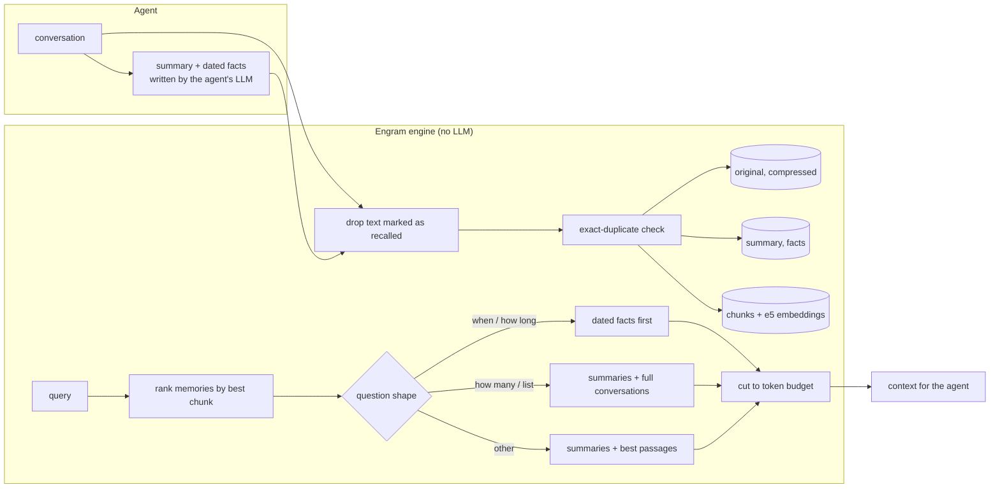

# Engram

**Can agent memory be modelled after a database?** Engram is my attempt at a memory store where the agent
only says *what* to remember and *what* it wants back, and the deterministic engine decides the *how*.

> This is a learning project. The idea came to me randomly, so I tested it one hypothesis at a time and kept
> whichever gave the best results. The results below are observations under one evaluation setup, not a claim
> that it is better.

## Why

Agents today keep memory in files, or hand it to a pipeline in which a language model decides what to extract,
update or delete. But won't the first approach struggle at scale, with so many files and folders to manage? And the
second depends on the model's decisions. Analysts faced a similar problem with raw data before databases, and the
answer then was a system with explicit rules for how data is stored, queried, changed and deleted, in other words
databases and SQL.

Engram applies that idea to agent memory. The agent never chooses where something goes.
Summarising a conversation is a basic skill of any agent, so the agent writes the summary
itself, and the engine stores it, indexes it, and serves it back under rules it applies the same way every time.

This version covers the storage and query side of that database. The maintenance side, checking and cleaning
memory as it grows, is the next step (see [Roadmap](#roadmap)).

## How it works



**Writing.** With `remember(text, summary, facts, timestamp)`, the engine removes any text it handed out earlier
(marked as recalled), drops exact duplicates, stores the original losslessly, and indexes the agent's summary,
its dated facts and paragraph-sized chunks of the text. Every write becomes a new memory. No model overwrites,
merges or deletes anything on its own.

**Reading.** With `recall(query)`, the engine ranks memories by their best-matching passage, chooses a layout from
the shape of the question, and returns at most a fixed number of tokens (1,300 by default). Reading makes no LLM
call.

**Deleting.** `forget()` hides memories and `restore()` brings them back. `purge()` deletes them permanently.
Nothing is deleted automatically.

### Compared with Mem0

| | Engram | Mem0 |
|---|---|---|
| Who decides what is stored | the agent (summary, facts) + fixed rules | Mem0's own LLM call on every write |
| Who can change or delete memory | only explicit calls (`forget`, `purge`) | Mem0's LLM (ADD / UPDATE / DELETE) |
| Original conversation | kept, losslessly, until an explicit purge | not kept (extracted memories only) |
| LLM calls inside the memory system | none | on every write |
| Read path | embeddings + rules | vector search (+ optional BM25) |

## Quick start

```bash
git clone https://github.com/Yunsmn/engram && cd engram
uv sync          # Python 3.11 or 3.12, the e5-large-v2 embedder (~1.3 GB) downloads on first use
```

```python
from engram.engine import Engram

mem = Engram.open("me.sqlite")
mem.remember("user: I moved from Paris to Berlin last week.",
             timestamp="2024-05-20T10:00",
             summary="The user moved from Paris to Berlin.",          # written by your agent
             facts=["The user moved to Berlin in May 2024."])        # optional, written by your agent
result = mem.recall("Where do I live?")
print(result.text)     # context for your model
print(result.marked)   # use this one if the conversation will itself be remembered later
```

## Results

I compared Engram with Mem0, a widely used open-source memory system, and with plain retrieval over chunks (flat
RAG) as a floor. Every system was given the same answering model (gpt-4.1-mini), the same budget of 1,300 tokens of
retrieved memory, and the same history, fed in units of two exchanges. Mem0 used gpt-4.1-mini as its own LLM.

### BEAM (the main test)

BEAM (ICLR 2026) contains long conversations between a user and an assistant, with questions on ten memory
abilities. I used the 128K split (20 conversations, 400 questions) and BEAM's rubric-based judge. The comparison was
fixed in advance and run once, and neither system was developed on this data.

| | Engram | Mem0 | Flat RAG |
|---|---|---|---|
| **Overall (400)** | **56.8** | **55.1** | 51.6 |
| Abstention | 77.5 | 65.0 | 80.0 |
| Contradiction resolution | 23.1 | 24.4 | 23.1 |
| Event ordering | 63.6 | 61.2 | 43.5 |
| Information extraction | 69.6 | 65.8 | 51.5 |
| Instruction following | 58.1 | 61.2 | 53.1 |
| Knowledge update | 55.0 | 55.0 | 55.0 |
| Multi-session reasoning | 68.3 | 66.0 | 65.1 |
| Preference following | 75.0 | 86.2 | 82.5 |
| Summarisation | 29.9 | 31.4 | 20.1 |
| Temporal reasoning | 47.5 | 35.0 | 42.5 |
| Context tokens (mean) | 1,291 | 1,096 | 1,284 |
| LLM calls inside the memory system | 0 | per write | 0 |

Engram and Mem0 are on par. The difference of +1.6 points has a 95% confidence interval of [−2.0, +5.3].
Re-scoring the same answers with a second judge (gpt-4o) gives the same difference (+1.6, [−1.5, +4.6]). Engram is
ahead on abstention and temporal reasoning, and Mem0 is ahead on preference following. Contradiction resolution is
weak for both systems.

**Caveats.** Mem0 was run in its default installation, without its optional BM25 keyword search
(`mem0ai[extras]`). A run with BM25 enabled has been collected and will be added once it is scored. Mem0's own
published BEAM numbers come from its managed platform, with about 7,000 tokens of context on the 1M and 10M splits,
so they are not comparable with these.

### A reliability problem, the feedback loop

A long-running agent recalls memories, talks about them, and that conversation is then stored. Without
protection, the recalled content is stored again under a new date. I simulated this on two development sets.

| | Clean | Polluted | Polluted, with recall markers |
|---|---|---|---|
| LoCoMo (dev, 233 questions) | 208 | 193 (−6.4) | 209 |
| Synthetic (dev, 143 questions) | 100 | 78 (−15.4) | 104 |

The pollution also doubles to triples the size of the store. Marking recalled text, so that the engine never stores
it again, restored the clean level in these tests. In database terms, the result of a query is not new data.
This only works when the agent passes recalled text along unchanged. Reworded recall is not caught yet.

### Simpler, at no measurable cost

An earlier version used a classifier to decide about duplicates and updates, and a local language model to merge
summaries. Removing both cost nothing measurable. On the 160 BEAM questions that both versions completed, the
simpler version scored 60.0 against 55.9 (+4.2, interval [−0.8, +9.2]).

### Earlier benchmarks

| Benchmark | Engram | Mem0 | Flat RAG | Note |
|---|---|---|---|---|
| LoCoMo (1,307 q) | 84.9 | 77.6 | 72.2 | earlier version (v5), Mem0 used about 800 of the 1,300 tokens |
| LongMemEval-S (500 q) | 76.6 | — | 61.2 | earlier version (v5) |

## How it got here

| Version | What changed | Why |
|---|---|---|
| v1 | Classifier (Jev / NLI) routing each memory into a topic tree, a local LLM for summaries and topic names, compressed originals and retrieval chunks | the first design, "SQL for agent memory" |
| v2 | updates must pass a check before they replace an old memory | false updates were hiding correct memories |
| v3 | flat store instead of the topic tree, the agent writes the summary, layout chosen by question shape | the tree changed ~3% of results for ~70% of the classifier calls |
| v4 | the agent also writes dated facts, used first for time questions | dates were the most common failure |
| v5 | stronger embedder (e5-large-v2) | most remaining misses were retrieval misses |
| v5.1–5.3 | links instead of LLM merges, recall markers, no classifier | each part either did not change results or fixed a measured problem |

## What I tried and dropped

- A topic tree with classifier routing.
- A classifier for duplicates, updates and when to fetch more context.
- A local language model to merge summaries.
- Keyword (BM25) search mixed into Engram's retrieval.
- Smaller chunks of one turn each.
- Letting the answering model ask for a full conversation when it needed one.
- Putting preferences, or conflicting statements, first.

## Limitations

- On the unseen test Engram matches Mem0 but does not beat it. Mem0 was tested in its default installation, and
  the run with its optional BM25 search has not been scored yet.
- Preference following is weaker than Mem0's, and contradiction resolution is weak for every system tested.
- The agent's summaries and facts are trusted as given. The original is always kept next to them, but the engine
  does not check them.
- The fix for the feedback loop only works if the agent passes recalled text along unchanged. If the agent rewords
  it, it is stored again.
- Memories beyond a few hundred per conversation, languages other than English, and memory that is not
  conversation (tool output, code) have not been tested yet.

## Roadmap

Every write adds a memory and nothing is ever condensed, so as memory grows, redundancy and contradictions will
accumulate unless something checks and maintains the store. Databases solve this with routine maintenance, and
that is the next part of Engram.

- **`analyze()`** computes statistics and a graph of connected memories, showing how they relate, how often they
  are recalled together, which ones are cold and which clusters grow fastest.
- **Cleanup** collapses exact repeats and moves cold memories to a lower tier.
- **Consolidation** is a routine job, run by an LLM, that adds derived records digested from large clusters and
  flags statements that contradict each other.
- **Scale tests** on BEAM's 1M and 10M splits will measure how much accuracy falls as memory grows, with and without
  maintenance.

## Reproducing the results

The benchmark harness needs an OpenAI-compatible endpoint for the answering model, the judge, the agent that
writes summaries and facts, and Mem0's LLM. Copy `.env.example` to `.env` and fill in `READER_*` (gpt-4.1-mini in
the reported runs) and, for the second judge, `OFFICIAL_JUDGE_*` (gpt-4o).

```bash
uv sync --extra eval
uv run python -m eval.beam.download          # BEAM 128K split, 20 conversations
uv run python -m eval.beam.preprocess        # 400 question files in data/beam
uv run python -m eval.beam.pregen_agent      # the agent's summaries and facts, written once into the cache
uv run python -m eval.run --run-id beam-test --systems engram flat_rag --offline
for c in $(uv run python -m eval.beam.ids --conversations); do
    MEM0_TOP_K=100 uv run python -m eval.baselines.run_mem0 --conversations $c --run-prefix beam-test
done                                         # needs pip install mem0ai==2.2.1
uv run python -m eval.beam.judge --run-id beam-test --systems engram flat_rag mem0
```

Every recalled context, answer and judge score behind the tables is in `results/`, and the tables are rebuilt from
them without any API call.

```bash
uv run python -m eval.beam.judge --run-id beam-test --systems engram-v531 flat_rag mem0 --report-only
```

`results/beam-test` contains excerpts of the BEAM conversations, which are shared under CC BY-SA 4.0.

## License

Apache 2.0. The BEAM data is under CC BY-SA 4.0 (BEAM authors, ICLR 2026).
